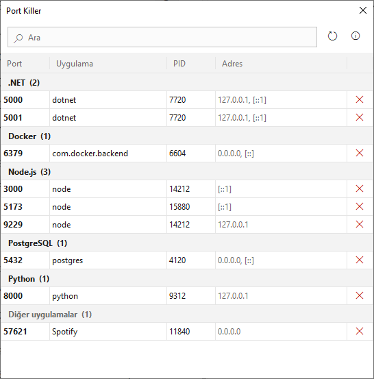
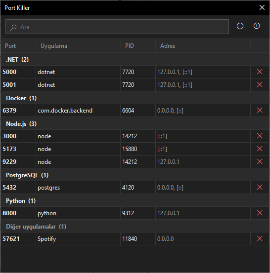
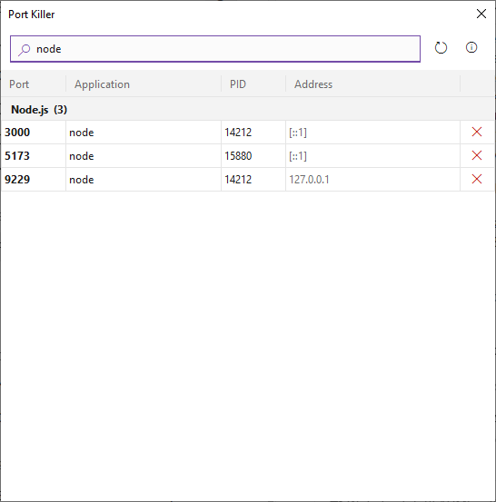
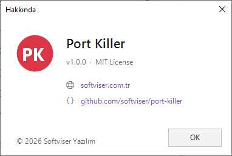

# Port Killer

[English](README.md) · [Türkçe](README.tr.md) · [Deutsch](README.de.md) · [Français](README.fr.md) · [Español](README.es.md) · [Português](README.pt-BR.md) · **Italiano** · [Русский](README.ru.md) · [简体中文](README.zh-CN.md) · [日本語](README.ja.md) · [한국어](README.ko.md)

Una piccola app per la barra delle applicazioni di Windows che mostra quale programma è in ascolto su quale porta di questo computer e termina con un clic i server di sviluppo rimasti bloccati.

La prossima volta che vedi `EADDRINUSE: address already in use :::3000`, invece di digitare `Get-NetTCPConnection -LocalPort 3000 | ... | Stop-Process` in PowerShell, clicca sull'icona nell'area di notifica e premi il pulsante ✕ accanto alla riga.

Realizzato da [Softviser Yazılım](https://softviser.com.tr). Open source con licenza MIT.

| Tema chiaro | Tema scuro |
|---|---|
|  |  |

## Download

Ogni versione nella pagina [Releases](https://github.com/softviser/port-killer/releases) contiene due build. Entrambe sono un singolo file senza installer e richiedono Windows 10 o 11 (64 bit).

| File | Dimensione | Requisito |
|---|---|---|
| `PortKiller-<version>-win-x64.exe` | ~66 MB | Nessuno; .NET è incluso |
| `PortKiller-<version>-win-x64-requires-net8.exe` | ~0.2 MB | [.NET 8 Desktop Runtime](https://dotnet.microsoft.com/download/dotnet/8.0) (x64) |

Se .NET 8 è già installato, come sulla maggior parte dei PC degli sviluppatori .NET, basta il file piccolo. Se il runtime manca, Windows mostra un messaggio con un link per scaricarlo.

L'eseguibile non è firmato digitalmente, quindi Windows SmartScreen potrebbe mostrare un avviso al primo avvio. Scegli **Ulteriori informazioni > Esegui comunque** per continuare. Puoi verificare il download con `SHA256SUMS.txt`:

```powershell
Get-FileHash .\PortKiller-*.exe -Algorithm SHA256
```

## Cosa fa

- Raggruppa per programma le porte TCP in ascolto (IPv4 e IPv6). Gli strumenti di sviluppo come Node.js, Python, .NET, Docker e PostgreSQL hanno gruppi propri in cima; tutto il resto finisce in "Altre applicazioni" in fondo.
- Il pulsante ✕ alla fine di ogni riga termina il processo, come `Stop-Process -Force` in PowerShell. Chiede conferma prima di terminare qualsiasi cosa che non sia uno strumento di sviluppo.
- L'elenco si aggiorna ogni 3 secondi. Quando una nuova porta inizia ad ascoltare, ricevi una notifica di Windows; cliccandola si apre l'elenco.
- La casella di ricerca filtra per porta, nome del programma, PID e indirizzo mentre scrivi. Digitare `:3000` o `3000` dà lo stesso risultato.
- L'interfaccia segue la lingua di visualizzazione di Windows (34 lingue). Anche il tema chiaro/scuro e il colore di accento derivano dalle impostazioni di Windows, e le modifiche si applicano senza riavviare l'app.
- Non richiede privilegi di amministratore. Può terminare i processi avviati con il tuo account utente.



### Cosa nasconde

Lo scopo dell'app è gestire le porte aperte durante lo sviluppo, non spegnere ciò che mantiene in funzione Windows. Perciò:

- Le porte inferiori a 1024 (servizi di Windows come SMB, RPC e HTTP.sys) non vengono elencate.
- I processi di sistema come `System`, `svchost`, `lsass`, `services`, `wininit`, `winlogon`, `csrss`, `smss`, `spoolsv`, Windows Defender e l'indicizzatore di ricerca non compaiono mai nell'elenco.

L'elenco dei programmi considerati strumenti di sviluppo è il dizionario `DevTools` in [`Ports.cs`](src/PortKiller/Ports.cs). Se manca uno strumento che usi, aggiungilo lì.

## Utilizzo

All'avvio dell'app, nell'area di notifica compare un'icona rossa "PK".

- **Clic sinistro:** apre o nasconde l'elenco delle porte.
- **Clic destro:** menu con Mostra porte, Aggiorna, Informazioni ed Esci.

Chiudere la finestra non chiude l'app: nasconde soltanto l'elenco. Per uscire del tutto, scegli **Esci** dal menu dell'area di notifica.

| Scorciatoia | Azione |
|---|---|
| F5 | Aggiorna l'elenco |
| Ctrl+F | Vai alla casella di ricerca |
| Delete | Termina il processo della riga selezionata |
| Esc | Cancella la ricerca; nasconde la finestra se la ricerca è vuota |



## Limitazioni note

- Per terminare un processo eseguito come amministratore (ad esempio PostgreSQL installato come servizio di Windows), anche Port Killer deve essere eseguito come amministratore. Altrimenti mostra un messaggio di errore.
- Con strumenti che si riavviano da soli, come `nodemon`, puoi ricevere un'altra notifica di "nuova porta" per la stessa porta se un riavvio coincide con il controllo ogni 3 secondi.
- Nel tema scuro, la barra di scorrimento che compare quando l'elenco non entra nella finestra resta chiara.
- Vengono mostrati solo i listener TCP; le porte UDP no.

## Compilare dai sorgenti

Requisiti: Windows 10 o 11 e il [.NET 8 SDK](https://dotnet.microsoft.com/download).

```powershell
git clone https://github.com/softviser/port-killer.git
cd port-killer

# Run during development
dotnet run --project src\PortKiller

# Single-file exe that also runs on machines without .NET (artifacts\PortKiller.exe)
dotnet publish src\PortKiller -c Release -r win-x64 --self-contained `
    -p:PublishSingleFile=true -p:IncludeNativeLibrariesForSelfExtract=true `
    -p:EnableCompressionInSingleFile=true -p:DebugType=none -o artifacts
```

### Struttura del progetto

| File | Contenuto |
|---|---|
| `Ports.cs` | Lettura delle porte in ascolto, elenchi degli strumenti di sviluppo e dei processi di sistema, terminazione dei processi |
| `TrayApp.cs` | Icona nell'area di notifica, menu, controlli periodici e notifiche |
| `PortsForm.cs` | Tabella delle porte raggruppata, ricerca e barra superiore |
| `AboutForm.cs` | Finestra Informazioni |
| `Strings.cs` | Testi dell'interfaccia in 34 lingue |
| `Theme.cs` | Colori basati sul tema chiaro/scuro e sul colore di accento di Windows |

### Traduzioni

I testi dell'interfaccia si trovano nella tabella in [`Strings.cs`](src/PortKiller/Strings.cs), una riga per lingua. Per aggiungere una lingua, inserisci il suo codice (come `"sr"` o `"pt-BR"`) e le 13 stringhe nello stesso ordine. Se noti un errore di traduzione, sentiti libero di aprire una issue o una pull request.

## Licenza

[MIT](LICENSE) © 2026 Softviser Yazılım
